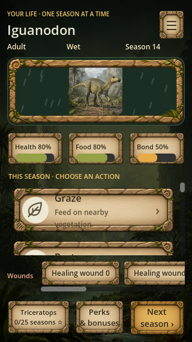
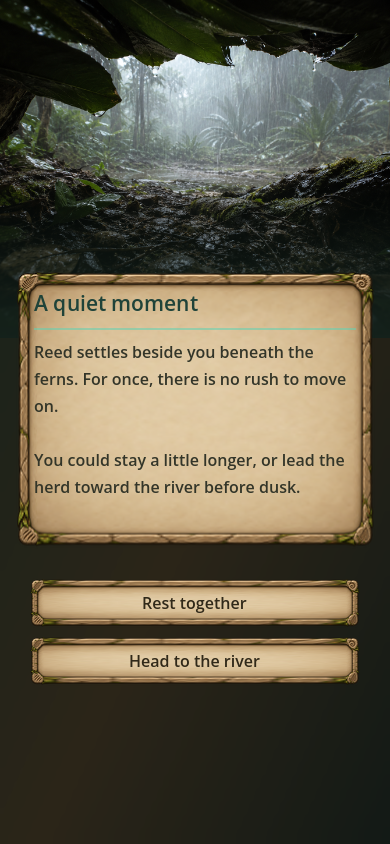

# DinoLife: Prehistoric Survival

A life-simulation game where you live one dinosaur's life from hatchling to elder, one season at a time. You make survival choices, build a pack, raise offspring, and unlock new species through what you accomplish.

**[Download on the App Store](https://apps.apple.com/us/app/dinolife-prehistoric-survival/id6783614616)** · Built with Godot 4 and GDScript · Solo project by Wandering Turtle Games

<p>
  
  &nbsp;
  
</p>

> This repository is a **source-code sample** for portfolio review. Art, audio, scenes, and release configuration are not included. See [NOTICE.md](NOTICE.md).

---

## Highlights

- **Shipped to the App Store**, with automated iOS builds, code signing, and upload through a Codemagic CI/CD pipeline.
- **About 57,000 lines of GDScript** across turn simulation, events, combat, pack behavior, parenting, journeys, and UI.
- **10 playable species** built on a shared module pattern. Each species plugs into the same systems without new engine code.
- **19 automated check scripts** that verify unlock paths, rewarded-ad actions, UI behavior, and world journeys.

## Architecture

The game runs as a turn loop. Each turn is one season:

```
character_select ──► game_screen ──► turn_manager.process_turn()
                                         │  runs prioritized event checks
                                         │  (nesting, mating, parenting, juvenile lessons…)
                                         ▼
                                   event_overlay  ◄── player picks a choice
                                         │
                                         ▼
                                  action_resolver.resolve(action, choice)
                                         │  loads species modules by path
                                         ├── combat_resolver (fights)
                                         ├── pack_manager (pack/herd)
                                         ▼
                              GameState.advance_season() → save_run()
```

### Species modules: data over subclasses

Every species is a folder of small modules under `scripts/dinos/<species_id>/`, such as `dino_hunt.gd`, `dino_mate.gd`, and `dino_nest.gd`. Each module extends a shared base class. The action resolver loads them by path at runtime:

```gdscript
"res://scripts/dinos/{species_id}/dino_hunt.gd"
```

Adding a species means adding a folder of content, not changing game systems. Species-specific behavior lives in optional modules. For example, only herbivores have `dino_graze.gd`, and only mother-bond species have `dino_maternal.gd`.

### Folder guide

| Folder | What's in it |
|---|---|
| `scripts/systems/` | Simulation systems: action and combat resolution, packs, companions, journeys, perks, world and habitat conditions |
| `scripts/managers/` | Global state, turn flow, saving and loading, unlocks, ads, audio |
| `scripts/dinos/` | Per-species content modules and their base classes |
| `scripts/data/` | Species and event databases |
| `scripts/story/` | Branching story mode with trust states, story flags, and multiple endings |
| `scripts/ui/` | Screens and widgets: game screen, event overlay, family and pack views, journal |
| `scripts/tests/` | Automated gameplay and UI checks |

## Engineering notes

- **Save system:** Runs are saved as JSON. Numbers are converted back to their original types on load, because JSON reads every number as a float or an int.
- **Native plugins:** AdMob rewarded and interstitial ads are tied to optional bonus actions. Plugin signals are connected directly, because Godot 4's `has_signal()` returns false for native plugin signals.
- **Code health:** The project caps scripts at 1,000 lines, and oversized files have written split plans. The largest systems are being broken up by responsibility as they're worked on.

## Tech

Godot 4.6 · GDScript · Codemagic CI/CD · App Store Connect · Google AdMob · AI-assisted development with Claude Code
